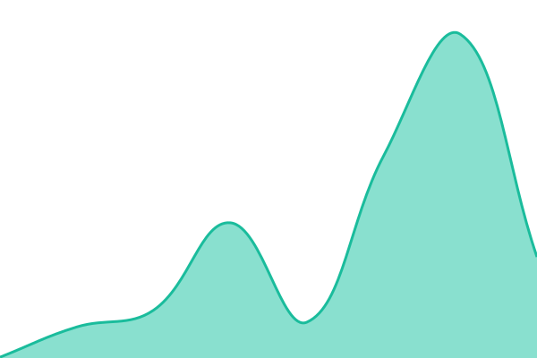
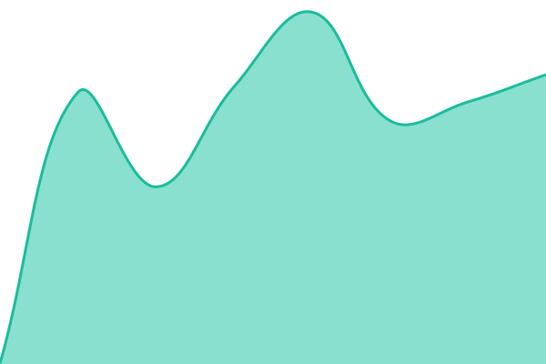
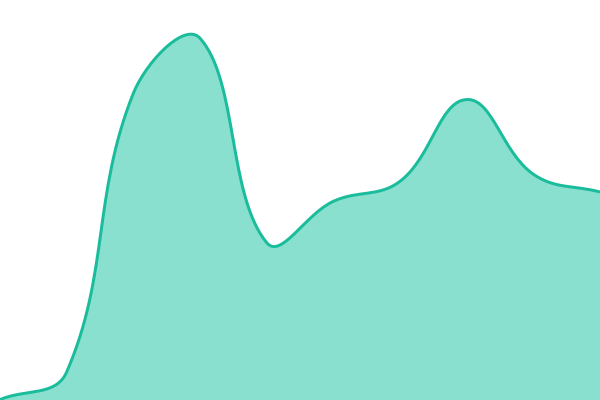
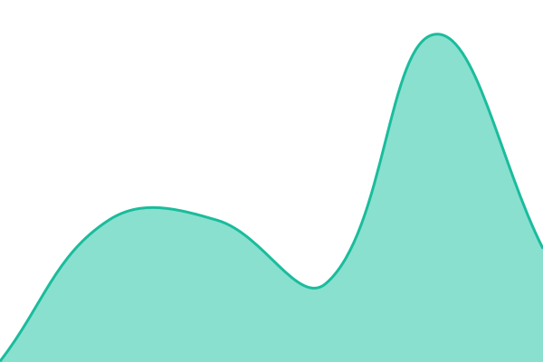

# havn status

This repository contains the open-source uptime monitor and status page for [carlitodag](https://status.havn.gg), powered by [Upptime](https://github.com/upptime/upptime).

With [Upptime](https://upptime.js.org), you can get your own unlimited and free uptime monitor and status page, powered entirely by a GitHub repository. We use [Issues](https://github.com/carlitodag/status/issues) as incident reports, [Actions](https://github.com/carlitodag/status/actions) as uptime monitors, and [Pages](https://status.havn.gg) for the status page.

<!--start: status pages-->
<!-- This summary is generated by Upptime (https://github.com/upptime/upptime) -->
<!-- Do not edit this manually, your changes will be overwritten -->
<!-- prettier-ignore -->
| URL | Status | History | Response Time | Uptime |
| --- | ------ | ------- | ------------- | ------ |
|  [Website](https://havn.gg) | 🟩 Up | [website.yml](https://github.com/carlitodag/status/commits/HEAD/history/website.yml) | 

 157ms
     
 | 

<a href="https://status.havn.gg/history/website">100.00%</a>
    

|  [Voice relay (Nuremberg)](https://voice.havn.gg) | 🟩 Up | [voice-relay-nuremberg.yml](https://github.com/carlitodag/status/commits/HEAD/history/voice-relay-nuremberg.yml) | 

 429ms
     
 | 

<a href="https://status.havn.gg/history/voice-relay-nuremberg">100.00%</a>
    

|  [Sign-in and accounts](https://fpdzhfrwvkxrouojbqjd.supabase.co/auth/v1/health) | 🟩 Up | [sign-in-and-accounts.yml](https://github.com/carlitodag/status/commits/HEAD/history/sign-in-and-accounts.yml) | 

 494ms
     
 | 

<a href="https://status.havn.gg/history/sign-in-and-accounts">100.00%</a>
    

|  Live messages | 🟩 Up | [live-messages.yml](https://github.com/carlitodag/status/commits/HEAD/history/live-messages.yml) | 

 0ms
     
 | 

<a href="https://status.havn.gg/history/live-messages">100.00%</a>
    

|  [File storage](https://fpdzhfrwvkxrouojbqjd.supabase.co/storage/v1/status) | 🟩 Up | [file-storage.yml](https://github.com/carlitodag/status/commits/HEAD/history/file-storage.yml) | 

 273ms
     
 | 

<a href="https://status.havn.gg/history/file-storage">100.00%</a>
    

|  [Server functions](https://fpdzhfrwvkxrouojbqjd.supabase.co/functions/v1/link-preview) | 🟩 Up | [server-functions.yml](https://github.com/carlitodag/status/commits/HEAD/history/server-functions.yml) | 

 314ms
     
 | 

<a href="https://status.havn.gg/history/server-functions">100.00%</a>
    

<!--end: status pages-->

[**Visit our status website →**](https://status.havn.gg)

## 📄 License

- Powered by: [Upptime](https://github.com/upptime/upptime)
- Code: [MIT](./LICENSE) © [Anand Chowdhary](https://anandchowdhary.com)
- Data in the `./history` directory: [Open Database License](https://opendatacommons.org/licenses/odbl/1-0/)
